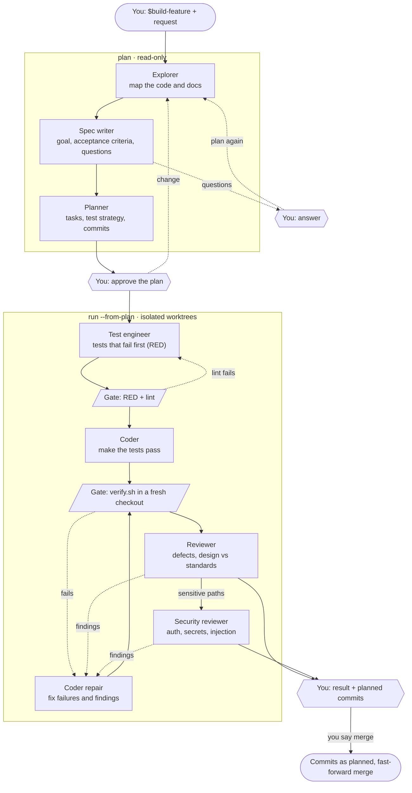

# Odium Agent: AI Engineering Nest

An orchestrator that takes a feature request from idea to verified, reviewed code. It runs **Codex CLI** or **Claude Code** as separate subagents, one per step, and checks their work itself: tests must fail before the code exists, pass in a fresh checkout afterwards, and go through an independent review. You approve the plan and decide on the merge.

## How it works



Each box is a separate subagent: its own Codex or Claude process, with its own model and effort per step. Gates are checks the orchestrator runs itself, not an agent. Dotted lines are loops with a fixed budget of attempts. Nothing is pushed: the result is a verified branch on your machine.

## Quick start

Requirements: Python 3.11+, Git, Bash, and the `codex` or `claude` CLI.

```bash
# Install into your project; --local keeps the Nest out of the project's Git history
python /path/to/odium-agent/install.py /your/git/repo --local --template python
```

Then, in the project, start a chat and describe the feature:

- Codex: `$build-feature <what you want>`
- Claude Code: `/build-feature <what you want>`

The chat comes back to you only with questions, with the plan for approval, and with the result.

**Run it in a disposable, credential-free VM or container.** Agents run the code they write; Git worktrees are not a security boundary.

## Documentation

[AI_NEST_README.md](AI_NEST_README.md) covers installation options, verify templates, models per step, limits, gates and the full workflow.
